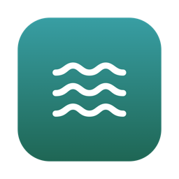
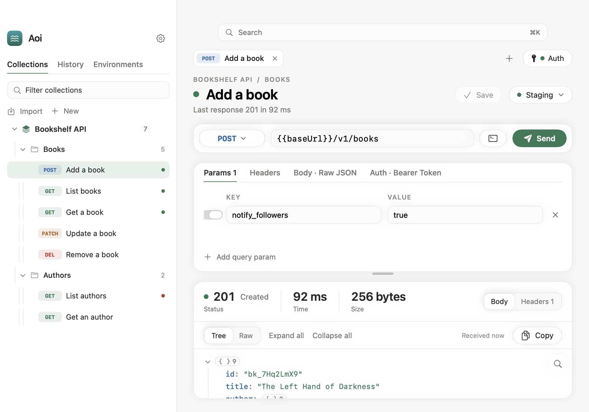

<div align="center">



<h1>Aoi</h1>

<p>A lightweight, fast, native macOS app for calling HTTP APIs.<br>
It imports your OpenAPI and Postman files, keeps requests, environments and responses in one window,<br>
and stays on your Mac with no account or cloud sync.</p>

<p>
  
  
  
</p>

<br>

<picture>
  <source media="(prefers-color-scheme: dark)" srcset="docs/request-dark.png">
  
</picture>

</div>

## Highlights

- **Lightweight and fast.** A native SwiftUI app of about 4 MB with no dependencies. It opens instantly and stays out of the way, with no Electron and no browser underneath.
- **Start from your specs.** Import OpenAPI 3, Swagger 2 or Postman collections and environments, as YAML or JSON. Requests arrive grouped in folders, with their auth, parameters and example bodies already filled in.
- **Switch environments in one click.** Each environment has a base URL that every request uses as `{{baseUrl}}`, plus any variables it needs. Values missing for the active environment are highlighted before you send.
- **Write bodies that match the API.** The JSON editor knows each endpoint's schema, so it suggests fields, types and allowed values as you type, at any depth, and flags required fields that are missing.
- **Chain requests without copying.** Right-click any value in a response to keep it as a variable, such as `{{book_id}}`, for the next request. These values last until you quit.
- **Stay safe on production.** Requests only go out when you click Send or press ⌘Return, and environments marked as production ask before anything that changes data. Settings let you ask for every request, or never.
- **Move fast.** Use tabs and history, jump anywhere with ⌘K, paste a curl command into the URL bar, or copy any request as one with its secrets hidden.

## Getting started

Requires macOS 14 or later and Swift 5.10 (Xcode 15 or newer). Build the app and install it in `/Applications`:

```bash
./bundle.sh
open /Applications/Aoi.app
```

Your collections, environments and settings are stored in `~/Library/Application Support/Aoi`. History and values taken from responses are kept only while the app is open.

## Development

Run the app without building a bundle, or run the tests:

```bash
swift run
swift test
```

The tests use a stub HTTP client and a temporary folder, so they never make real requests or touch your data.

## License

[MIT](LICENSE)

<br>

<p align="center"><sub>Made by João Oliveira</sub></p>
